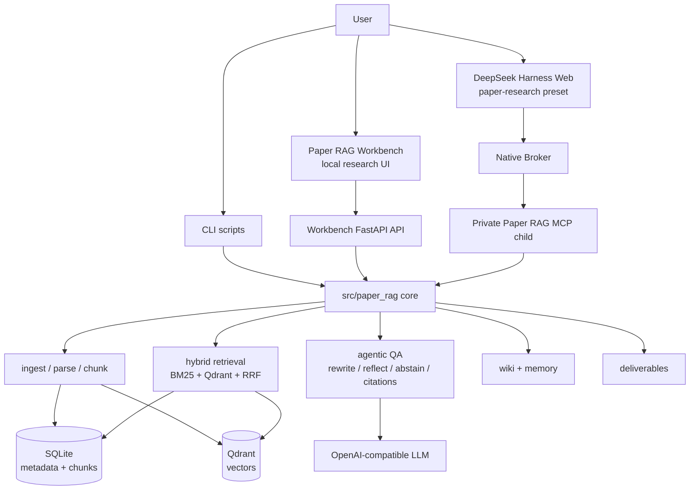

# Paper RAG Agent

English | [中文](README_ZH.md)

[](https://github.com/TongTong0828/project-showcase-tong/actions/workflows/ci.yml)
[](pyproject.toml)
[](LICENSE)

Paper RAG Agent is a local-first research workbench for academic papers. It
ingests arXiv papers, PDF URLs, and local PDFs; parses and chunks the text;
builds a SQLite + Qdrant hybrid index; and answers research questions with
evidence-constrained citations.

This public showcase snapshot highlights the DeepSeek Harness (DSH)
integration, the private MCP tool bridge, and the Paper RAG Workbench UI. It is
intended as a portfolio-ready view of the engineering work: system boundaries,
retrieval quality controls, evaluation gates, and local operations.

## At a Glance

| Area | What this project demonstrates |
| --- | --- |
| Local research workspace | Paper RAG Workbench for ingestion, QA, traces, wiki building, feedback, and deliverables |
| Agent host | DeepSeek Harness `paper-research` preset with Native Broker and a private Paper RAG MCP child |
| RAG engineering | SQLite metadata, FTS5/BM25 sparse search, Qdrant dense vectors, RRF fusion, and optional reranking |
| Evidence discipline | Query rewriting, HyDE, reflective retrieval, abstention, citation validation, and explicit `[chunk:<id>]` references |
| Evaluation | Golden retrieval sets, no-judge QA checks, citation audits, claim-level evals, and DSH smoke/type/test gates |
| Operations | Runtime isolation, config checks, secret scanning, CI, Docker image path, and observability references |

## Why It Exists

Academic-paper QA needs stronger guarantees than a simple "retrieve top-k chunks
and ask a model" demo. Users need to know where an answer came from, whether the
evidence is strong enough, and how retrieval decisions affected the final
response.

This project treats paper QA as an auditable pipeline:

1. Candidate papers can be discovered, but they cannot be cited until they are
   ingested and indexed.
2. Final answers must be grounded in selected chunks, not titles, abstracts,
   memory, or external metadata.
3. Citations use explicit `[chunk:<id>]` references and are checked before an
   answer is accepted.
4. Evaluation covers retrieval, generation, citations, abstention, claims,
   agent tools, and host integration.

## Architecture



Design boundaries:

- `src/paper_rag/` is host-agnostic and does not import DSH or UI code.
- The DSH adapter lives in `integrations/deepseek-harness/`.
- The Workbench lives in `integrations/paper-rag-workbench/`.
- MCP tools return structured results; credentials and runtime authority stay
  outside model-visible context.
- Runtime data is separated from the paper library and index data.

## Demo Flow

The quickest way to evaluate the project is to run the local Workbench and DSH
smoke checks:

1. Ingest a paper, for example Self-RAG: `2310.11511`.
2. Ask a research question such as `What is Self-RAG?`.
3. Inspect the retrieval trace, selected evidence, abstain decision, and chunk
   citations.
4. Build a wiki note or generate a survey-style deliverable from indexed papers.
5. Run the DSH smoke/type/test gates to verify host integration.

Local entry points:

- Workbench: `http://127.0.0.1:3090`
- DSH Chat: `http://127.0.0.1:3080`

## Quick Start

### 1. Clone

```bash
git clone https://github.com/TongTong0828/project-showcase-tong.git
cd project-showcase-tong
```

### 2. Install the Python package

```bash
python -m venv .venv
. .venv/bin/activate
python -m pip install -U pip
python -m pip install -e ".[dev,ingest,embed,deliver,deliver-pdf,harness]"
```

For lightweight test runs, the `embed`, `ingest`, and deliverable extras can be
omitted.

### 3. Configure environment

```bash
cp .env.example .env
```

Model defaults:

```bash
CHAT_MODEL=deepseek-v4-flash
SMALL_MODEL=deepseek-v4-flash
PAPER_RAG_DSH_PORT=3080
```

Do not commit `.env`, API keys, `data/index`, runtime credentials, real PDFs, or
temporary test data.

### 4. Initialize the local index

```bash
make qdrant-up
make init-store
```

### 5. Install and start DeepSeek Harness

```bash
make dsh-install
make dsh-doctor
make dsh-start
```

### 6. Start Paper RAG Workbench

```bash
make workbench
```

## Common Commands

```bash
make dsh-smoke
make dsh-test
make test
make test-pytest
make smoke
make secret-scan
make eval-golden
make eval-golden-qa
make eval-citation-audit
make eval-claims
make verify-p0
```

Offline QA example:

```bash
make ingest ID=2310.12345
make ask Q='What problem does this paper solve?'
```

## Repository Layout

```text
.dsh/                                  DSH skill entry for paper research
src/paper_rag/                         Host-agnostic Python RAG core
integrations/deepseek-harness/         DSH preset, broker, MCP launch path, tests
integrations/paper-rag-workbench/      Local Workbench frontend/backend assets
scripts/                               Local operations, eval, and smoke scripts
tests/                                 Pure logic tests and evaluation fixtures
specs/20260813-deepseek-harness-migration/
docs/                                  Architecture, ADRs, operations, and reports
config/                                Local/default/production configuration
```

Common local data directories:

```text
data/index/                    SQLite, local Qdrant index, gate reports
data/runtime/deepseek-harness/ DSH profile/session/runtime
data/papers/                   Source PDFs
data/parsed/                   Parsed outputs and local assets
artifacts/                     Deliverable output
```

`data/` and runtime artifacts are ignored by default.

## Documentation

- [docs/README.md](docs/README.md): documentation map and ADR index
- [docs/ARCHITECTURE.md](docs/ARCHITECTURE.md): system architecture
- [docs/SYSTEM_DESIGN.md](docs/SYSTEM_DESIGN.md): end-to-end design
- [docs/OPERATIONS.md](docs/OPERATIONS.md): operations guide
- [docs/RAG_EVAL_GUIDE.md](docs/RAG_EVAL_GUIDE.md): evaluation commands, datasets, and gates
- [specs/20260813-deepseek-harness-migration/](specs/20260813-deepseek-harness-migration/): DSH migration spec and gate evidence
